<div align="center">

# 👟 Nike Shop

**A polished, animation-rich shoe store built with Flutter.**
Swipe through shoes, pick a size and color, save favorites, check out, and track your orders.


<br>

<table>
  <tr>
    <td align="center">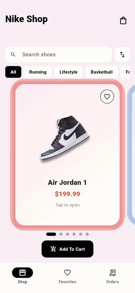</td>
    <td align="center">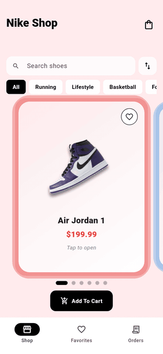</td>
    <td align="center">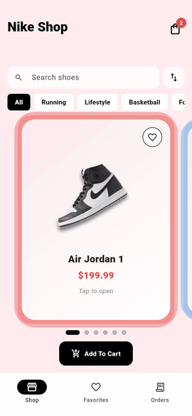</td>
  </tr>
  <tr>
    <td align="center"><sub><b>Browse</b></sub></td>
    <td align="center"><sub><b>Choose &amp; add</b></sub></td>
    <td align="center"><sub><b>Check out</b></sub></td>
  </tr>
</table>

[Features](#-features) · [Animations](#-animations) · [Colors & styling](#-colors--styling) · [Screens](#-screens) · [Getting started](#-getting-started) · [Project structure](#-project-structure)

</div>

---

## ✨ Features

| | |
|---|---|
| 🎠 **Shop carousel** | Animated shoe cards, a fly-to-cart animation and a live cart badge |
| 🔍 **Search, filter, sort** | Search by name, description or category · filter by Running, Lifestyle, Basketball, Football · sort by price or name · friendly empty state |
| 📏 **Size & color** | US sizes 6–12 with out-of-stock sizes struck through · three colorways per shoe · a size is required before adding |
| ❤️ **Favorites** | Heart any shoe from the card or detail page · dedicated Favorites tab |
| 🛒 **Cart** | Per-line size and color · quantity controls · live total · the same shoe in another size is its own line |
| ✅ **Checkout & orders** | Animated checkout with a processing state · confetti confirmation · Orders tab with a Placed → Shipped → Delivered tracker |
| 🧾 **PDF receipt** | Print or save a receipt (with each shoe's photo, size, color and totals) from the confirmation screen or any order |
| 💾 **Persistence** | Cart, favorites and orders survive an app restart; corrupt or outdated saved data is ignored instead of crashing |

> **Demo behavior worth knowing**
> - There is no backend. Order status is simulated from the order's age: *Shipped* after 1 minute, *Delivered* after 3 (`Order.kShippedAfter` / `Order.kDeliveredAfter`).
> - No real payment is taken; the chosen payment method is just recorded on the order.
> - All colorways of a shoe share one product photo. Choosing a colorway changes the swatch, the page tint and the cart/order text, not the picture.
> - "Buy Now" orders a single shoe and leaves the cart alone; checking out from the cart empties it.

---

## 🎬 Animations

Everything is built with Flutter's own animation widgets and controllers. No animation packages. The clips below are rendered from the real app, frame by frame.

<table>
  <tr>
    <td width="270" align="center"></td>
    <td valign="top">

### 🎠 Carousel
- **Color-shifting background**: the page cross-fades to each shoe's tint (550 ms).
- **Pulsing glow**: the selected card's shadow in the shoe's accent color breathes (1.7 s, looping).
- **Focus scaling**: side cards shrink to 0.94 and fade to 78% (260 ms).
- **Page dots**: the active dot stretches into a pill (300 ms).
- **Press feedback**: the card dips to 0.97 while held (140 ms).

`animated_shoe_card.dart` · `shop_screen.dart`

</td>
  </tr>
  <tr>
    <td width="270" align="center"></td>
    <td valign="top">

### 👟 Tap, detail & fly-to-cart
- **Tap spin**: the shoe does a full 360° with a lift and bounce (620 ms) before the page opens.
- **Hero + route transition**: fade, slide, slight rotation and scale with `easeOutBack` (420 ms).
- **Floating shoe**: gentle up-and-down bob (2.4 s, looping).
- **Entry**: the white panel slides up while the page fades in (550 ms).
- **Chips**: color and size selection animate (200 ms); a missing size shows a red prompt.
- **Fly-to-cart**: the shoe arcs along a curve into the cart icon, shrinking as it goes (1.18 s), then the badge pops (280 ms).

`shoe_detail_screen.dart` · `navigation.dart` · `variant_selectors.dart`

</td>
  </tr>
  <tr>
    <td width="270" align="center">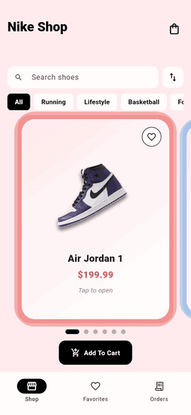</td>
    <td valign="top">

### 🔍 Search, filter & sort
- Results update as you type, and the carousel jumps back to the first match.
- Category chips and the sort menu combine with the search text.
- The background re-tints to whichever shoe is now first.

`shop_screen.dart` · `shop_filter_provider.dart`

</td>
  </tr>
  <tr>
    <td width="270" align="center">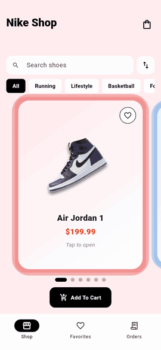</td>
    <td valign="top">

### ❤️ Favorites
- **Heart pop**: an elastic bounce when you toggle a favorite (380 ms).
- The Favorites tab reflects the change instantly; it is stored on the device.

`wishlist_button.dart` · `favorites_screen.dart`

</td>
  </tr>
  <tr>
    <td width="270" align="center"></td>
    <td valign="top">

### ✅ Checkout, confirmation & orders
- **Staggered entry**: sections slide and fade in one after another; the shoes you're buying pop into the summary.
- **Counting total**: the total counts up from $0 as the page opens (1.1 s).
- **Payment cards**: each method has an icon; the selected one turns black, its icon grows and a check bounces in (240 ms).
- **Processing button**: "Checkout Now" morphs into a spinner with *Processing...* for 1.5 s before the order is placed. Leaving the page during this cancels the order.
- **Confirmation**: a black badge pops in with an elastic bounce, the checkmark **draws itself** with a `CustomPainter`, **confetti** in your shoes' colors falls over the screen (3.2 s), and the purchased shoes pop in one by one.
- **Order tracker**: step circles and connecting lines fill as the status advances (400 ms).

`checkout_screen.dart` · `order_confirmation_screen.dart` · `orders_screen.dart`

</td>
  </tr>
</table>

---

## 🎨 Colors & styling

A clean, high-contrast base of **black and white**, with each shoe bringing its own color. The app uses Material 3 with `ColorScheme.fromSeed(seedColor: Colors.black)`.

### Every shoe has its own theme

<p align="center">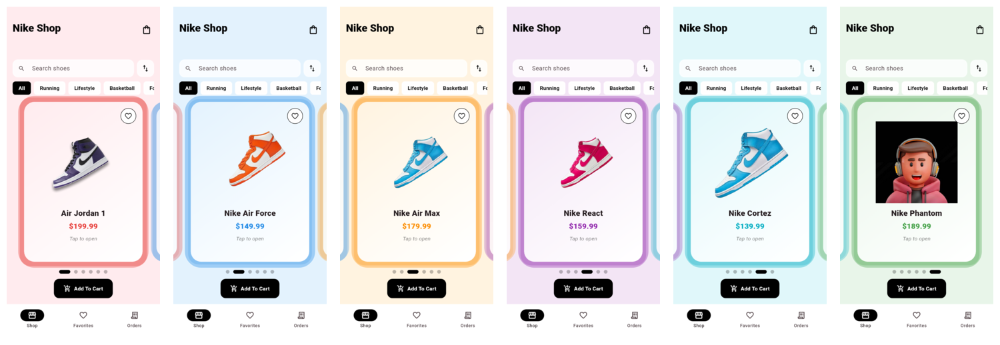</p>

Each shoe defines an **accent** (prices, glow and shadows) and a light **background tint** that the page fades to as you swipe (`lib/features/shop/data/shoes_data.dart`).

| Shoe | Accent | Background tint |
|---|---|---|
| Air Jordan 1 |  |  |
| Nike Air Force |  |  |
| Nike Air Max |  |  |
| Nike React |  |  |
| Nike Cortez |  |  |
| Nike Phantom |  |  |

On the detail page the background is tinted by the chosen **colorway** (that color at 16% opacity over white), and each shoe has three colorways, for example *Chicago Red*, *Shadow Black* and *Royal Blue*.

### Shared UI colors

| Use | Color |
|---|---|
| Primary buttons, selected chips, nav indicator, order tracker |  |
| Surfaces, cards, detail panel |  |
| Summary panels, order cards, cart footer |  |
| Cart badge, favorited heart, errors, remove |  |
| Totals and order amounts |  |

### Shape & type
- **Rounded everything**: 28 on shoe cards, 30 on the detail panel, 12–14 on buttons, chips and inputs, 20 on order and favorite cards.
- **Heavy weights for emphasis**: titles and prices use `w800`/`w900`; supporting text is regular or `w600`.
- **Soft colored shadows** on the shoe cards, using each shoe's accent.
- The default Material font (Roboto on Android) is used; no custom fonts are bundled.

---

## 📱 Screens

<table>
  <tr>
    <td align="center"><br><sub><b>Shop</b></sub></td>
    <td align="center">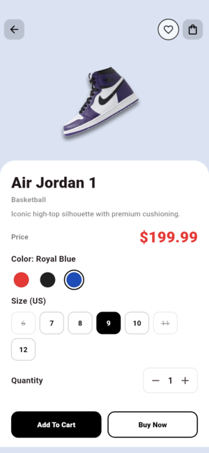<br><sub><b>Detail</b></sub></td>
    <td align="center">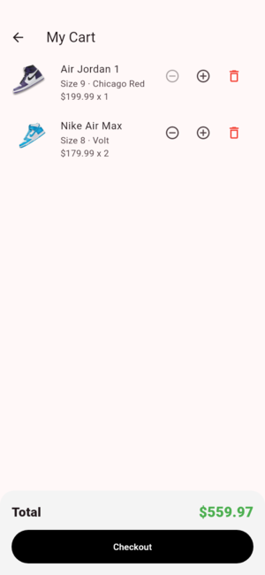<br><sub><b>Cart</b></sub></td>
    <td align="center">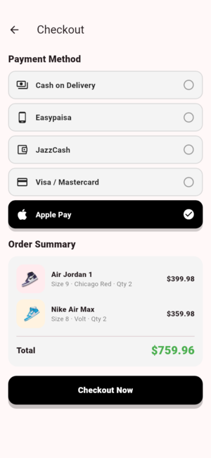<br><sub><b>Checkout</b></sub></td>
  </tr>
  <tr>
    <td align="center">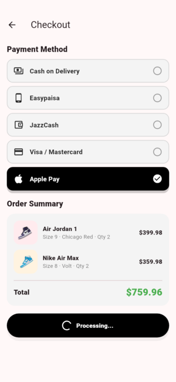<br><sub><b>Processing</b></sub></td>
    <td align="center">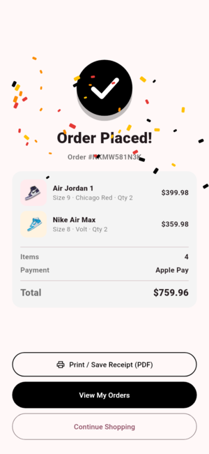<br><sub><b>Confetti</b></sub></td>
    <td align="center">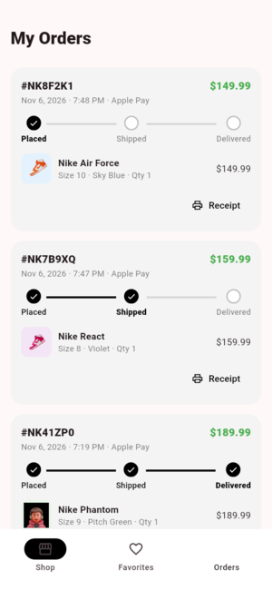<br><sub><b>Orders</b></sub></td>
    <td align="center">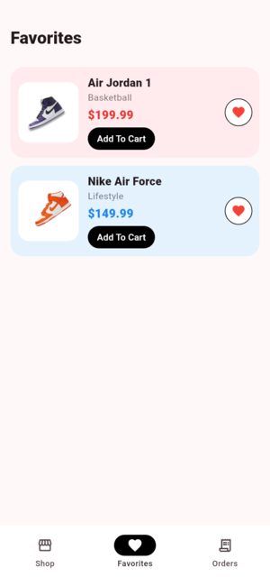<br><sub><b>Favorites</b></sub></td>
  </tr>
</table>

### 🧾 Receipt

Tap **Print / Save Receipt (PDF)** on the confirmation screen (or **Receipt** on any order in the Orders tab) to open Android's print dialog. From there you can print it or choose *Save as PDF*. The receipt lists every shoe with its photo, size, color, quantity and price, plus the total.

<p align="center">
  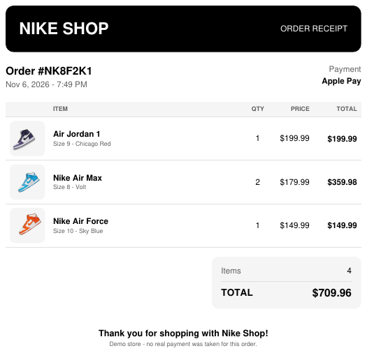<br>
  <sub><a href="docs/media/sample-receipt.pdf">Open a sample receipt (PDF)</a></sub>
</p>

---

## 🚀 Getting started

Requires Flutter (Dart SDK `^3.9.2`).

```bash
flutter pub get
flutter run
```

Run the checks:

```bash
flutter analyze
flutter test
```

<details>
<summary><b>Android build notes</b></summary>

With the current Flutter release the Android build needs **Gradle 8.14+**, **Android Gradle Plugin 8.11.1+** and **Kotlin 2.2.20+**. These are set in `android/gradle/wrapper/gradle-wrapper.properties` and `android/settings.gradle.kts`. The Gradle and Kotlin daemons are capped at 3 GB and 2 GB in `android/gradle.properties`. If the build dies with "Gradle build daemon disappeared unexpectedly", the machine ran out of memory: close other heavy apps, or run `./gradlew --stop` inside `android/` and try again.

</details>

---

## 📦 Releases (APK)

A GitHub Actions workflow (`.github/workflows/release.yml`) builds the app and publishes the APK under the repo's **Releases** page.

**To publish a release**, push a version tag:

```bash
git tag v1.0.0
git push origin v1.0.0
```

The workflow runs `flutter analyze` and `flutter test`, builds a release APK, and attaches `nike-shop-v1.0.0.apk` and its `.sha256` checksum to a new Release with auto-generated notes. The tag sets the app's version (`v1.0.0` → `1.0.0`) and the run number sets the build number. Use plain `vMAJOR.MINOR.PATCH` tags.

You can also run it by hand from the **Actions** tab (*Release APK → Run workflow*). That builds the APK and attaches it to the run as a downloadable artifact, without creating a Release.

### Signing (recommended)

Without a keystore, the APK is signed with a temporary debug key that changes on every run. It installs fine, but **a new release cannot update an older install** (Android rejects a different signature). To fix that, create a keystore once and add it as repository secrets:

```bash
keytool -genkeypair -v -keystore upload-keystore.jks -alias upload \
  -keyalg RSA -keysize 2048 -validity 10000
base64 -w0 upload-keystore.jks     # copy this output (macOS: base64 -i upload-keystore.jks)
```

Then in your repo go to **Settings → Secrets and variables → Actions → New repository secret** and add:

| Secret | Value |
|---|---|
| `ANDROID_KEYSTORE_BASE64` | the base64 text from above |
| `ANDROID_KEYSTORE_PASSWORD` | the keystore password you chose |
| `ANDROID_KEY_ALIAS` | `upload` (or the alias you used) |
| `ANDROID_KEY_PASSWORD` | the key password you chose |

> ⚠️ Keep `upload-keystore.jks` somewhere safe and **never commit it** (it is already git-ignored). If you lose it you can no longer publish updates that install over existing copies.

Local release builds still work without any of this: `android/app/build.gradle.kts` falls back to the debug key when `android/key.properties` is absent.

---

## 🧱 Project structure

```
lib/
  main.dart                  # loads SharedPreferences, starts the ProviderScope
  app.dart                   # MaterialApp + theme
  features/shop/
    data/                    # shoes_data.dart (static catalog)
    domain/                  # models (Shoe, CartItem, Order) + formatters
    application/             # Riverpod providers (state + persistence)
      cart_provider.dart
      wishlist_provider.dart
      orders_provider.dart
      shop_filter_provider.dart     # search / category / sort
      receipt_pdf.dart              # builds the PDF receipt
      home_tab_provider.dart
      preferences_provider.dart
    presentation/
      screens/               # home_shell, shop, shoe_detail, cart, checkout,
                             # order_confirmation, favorites, orders
      widgets/               # animated_shoe_card, wishlist_button,
                             # variant_selectors, quick_add_sheet, receipt_actions
test/
  cart_and_orders_test.dart  # unit tests: cart, wishlist, orders, filtering
  widget_test.dart           # widget tests: search, add to cart, checkout flow, layout
tool/readme_media/           # regenerates the GIFs and screenshots in docs/media
.github/workflows/           # release.yml: builds the APK and publishes a Release
docs/media/                  # README images
```

### State management

State lives in [Riverpod](https://riverpod.dev) `NotifierProvider`s. Screens read and update the cart, favorites, orders and filters through providers instead of passing lists and callbacks around. Each provider that needs persistence reads its saved value in `build()` and writes back on every change (`shared_preferences`).

### Adding a shoe

Add an entry to `kShoes` in `lib/features/shop/data/shoes_data.dart` with a category, colorways and (optionally) out-of-stock sizes, and put the image in `assets/`. Saved carts and orders that reference a shoe id that no longer exists are dropped when loaded.

### Regenerating the README media

The GIFs and screenshots are rendered by driving the real app headlessly (no device needed):

```bash
export MEDIA_OUT=/tmp/nike_media
flutter test tool/readme_media/capture_test.dart
tool/readme_media/build_media.sh "$MEDIA_OUT"   # needs ffmpeg and ImageMagick (and pdftoppm for the receipt preview)
```

---

## 📦 Dependencies

| Package | Used for |
|---|---|
| `flutter_riverpod` | state management |
| `shared_preferences` | local persistence |
| `pdf` | building the receipt PDF |
| `printing` | print dialog, save and share for the receipt |
